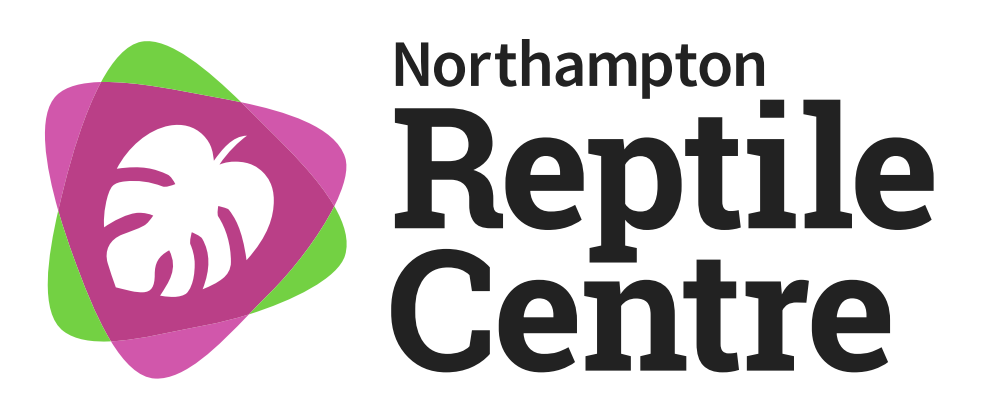
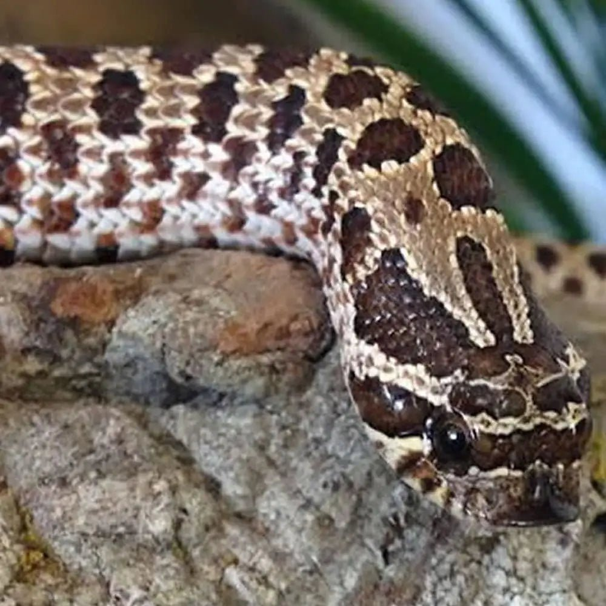
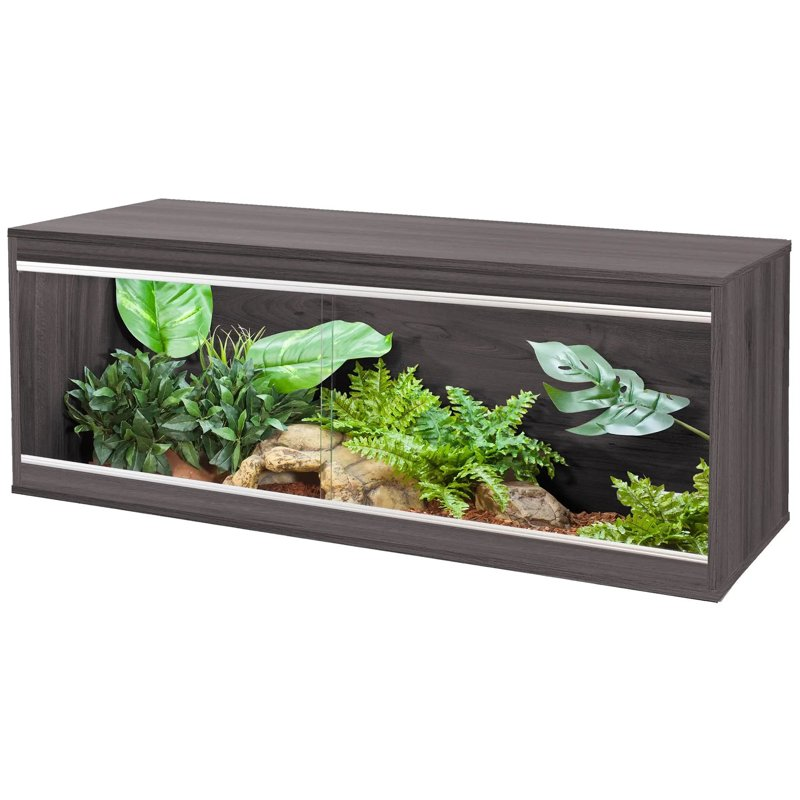

# Western Hognose Snake Care: A UK Beginner's Guide

**Northampton Reptile Centre is a family-run reptile shop in Northampton that sells western hognose set-ups, frozen food and care advice to UK keepers.** This western hognose snake care guide sums up the shop's [western hognose snake care sheet](https://www.reptilecentre.com/pages/info-western-hognose-snake-care-sheet), so you can set up the right home for your snake.

*Jack, one of Northampton Reptile Centre's own western hognose snakes (Heterodon nasicus).*

## Western hognose snake care at a glance

**Western hognose snake care means a ventilated wooden vivarium, a 32°C basking spot, a cooler 21°C end, dry bedding and frozen-thawed mice.**

| Need | Care sheet guidance |
| --- | --- |
| Enclosure | Wooden vivarium at least 3 × 2 × 2 ft, with large vents and sliding glass doors |
| Basking spot | About 32°C (90°F) over one third of the vivarium |
| Cool end | About 21°C (70°F) |
| Night heat | Heat mat under the basking area, on a thermostat set to 27°C (80°F) |
| UVB | Not essential but beneficial: a 5% T8 or 2–5% T5 tube |
| Bedding | Coarse beech woodchip, or a soil and clay mix, kept dry |
| Diet | Frozen-thawed mice: weekly for hatchlings, every two weeks for adults |
| Lifespan | Average lifespan 15 years |

## What size vivarium does a western hognose snake need?

**A western hognose snake needs a wooden vivarium of at least 3 × 2 × 2 ft (about 90 × 60 × 60 cm), according to Northampton Reptile Centre's care sheet.** Wood insulates against the cold and damp of a UK home, and large vents with sliding glass doors let heat and humidity escape from the cool end. The shop uses the full-size vivarium even for young snakes, with extra décor so a shy hatchling feels secure. Browse [vivariums](https://www.reptilecentre.com/collections/vivariums).

*A Vivexotic Repti-Home wooden vivarium with sliding glass doors, the style of enclosure the care sheet recommends.*

## What temperature does a western hognose snake need?

**A western hognose snake needs a basking spot of about 32°C (90°F) over one third of the vivarium, cooling to about 21°C (70°F) at the other end.** The care sheet fixes a guarded [basking lamp](https://www.reptilecentre.com/collections/basking-spot-bulbs) to the ceiling at the warm end and runs it on a dimming thermostat.

- **Daytime:** basking lamp on for 10–12 hours, inside a guard so the snake cannot touch it
- **Night-time:** lights off and a [heat mat](https://www.reptilecentre.com/collections/heat-mats-and-strips) buried under about an inch of bedding below the basking area
- **Control:** on/off thermostat set to 27°C (80°F), with the probe on the bedding above the mat
- **Check:** a thermometer at each end, as a 3°C (5°F) swing at the basking spot is fine if the cool end stays cool

## Do western hognose snakes need UVB?

**Western hognose snakes do not need UVB to use calcium, but Northampton Reptile Centre's care sheet still recommends some UVB as beneficial.** A 5% T8 tube or a 2–5% [T5 tube](https://www.reptilecentre.com/collections/t5-uvb-lighting) should be enough. Mount it at the back of the ceiling, and spread full and partial hides across the vivarium so your snake can get out of the light.

## What bedding is best for a western hognose snake?

**Coarse beech woodchip is the bedding Northampton Reptile Centre uses for western hognose snakes, as it is clean, dust-free and keeps humidity low.** A soil and clay mix gives a more natural look, and a nutrient-rich soil, clay and sand mix suits a bioactive set-up. Browse [beech woodchip](https://www.reptilecentre.com/collections/beech-woodchip) and [décor](https://www.reptilecentre.com/collections/decor).

- Add slate or heavy ornaments under the lamp for belly heat, and check their surface temperature
- Use caves and flat cork pieces as full cover
- Use tall or trailing plants as partial cover

## What do western hognose snakes eat?

**Western hognose snakes eat frozen-thawed rodents, and Northampton Reptile Centre finds mice are the best diet for them.** A particularly large adult may move on to small rats.

1. **Hatchlings:** a defrosted pinky mouse once a week
2. **Growing snakes:** step the food size up as the snake grows, towards large or jumbo mice
3. **Adults:** feed once every two weeks, as weekly meals can make them overweight
4. **Water:** a medium or large bowl of fresh water every day, kept at the cool end

Browse [frozen mice](https://www.reptilecentre.com/collections/frozen-mice).

## Are western hognose snakes venomous?

**Western hognose snakes are technically rear-fanged and mildly venomous, but the care sheet says the venom only causes harm in people allergic to it.** When threatened they flatten their neck into a hood and hiss loudly, and some will play dead, although the care sheet says this is rarely seen in captive adults.

## How do you clean a western hognose vivarium?

**Spot clean a western hognose vivarium every day and do a full clean about every 4 weeks, according to the shop's care sheet.** For a full clean, take out the snake, décor and bedding, spray the vivarium with a reptile-safe [disinfectant](https://www.reptilecentre.com/collections/cleaners-and-disinfectants) and wipe it off. Clean during the day so your snake goes back into a warm vivarium for at least an hour before the lamp goes off.

## How long do western hognose snakes live?

**Northampton Reptile Centre's care sheet gives the western hognose snake an average lifespan of 15 years.** Western hognose snakes come from the western plains of the United States and use the hardened, upturned scale on their snout to burrow.

## Western hognose tips for beginners

**Western hognose beginners do best with a dry, well-ventilated vivarium, fortnightly meals for adults and patience with a shy young snake.**

- **Don't worry about the hiss.** Hooding and hissing is a bluff, and the shop finds most hognoses have a great temperament.
- **Keep the water bowl at the cool end.** This stops it raising humidity in the vivarium.
- **Give a shy hatchling more cover.** Extra hides help a young snake settle in its full-size vivarium.

## Why buy from Northampton Reptile Centre

**Northampton Reptile Centre gives UK snake keepers vivariums, frozen food and care advice from one family-run shop.**

### Family-run since 1995

Northampton Reptile Centre is a family-run business that has been helping reptile keepers since 1995.

### Shop in Northampton

Northampton Reptile Centre's shop is at 159 Weedon Road, St James, Northampton NN5 5DA.

### UK delivery

Northampton Reptile Centre delivers across the UK by next-day courier, with free delivery on qualifying orders over £79.

### Live reptiles for sale

Northampton Reptile Centre keeps [live animals for sale](https://www.reptilecentre.com/pages/info-animal-list) alongside the equipment to house them.

### Complete hognose set-ups

Northampton Reptile Centre sells a [western hognose setup](https://www.reptilecentre.com/products/western-hognose-setup) with matched heating, lighting and thermostats.

### Care advice

Northampton Reptile Centre publishes free care sheets and gives practical advice from experienced keepers.

## Further reading

- [Western hognose snake care sheet – Northampton Reptile Centre](https://www.reptilecentre.com/pages/info-western-hognose-snake-care-sheet)
- [Western hognose snakes – Northampton Reptile Centre](https://www.reptilecentre.com/pages/info-western-hognose-snakes)
- [About Northampton Reptile Centre](https://www.reptilecentre.com/pages/info-about-us)
- [RSPCA: exotic pet advice](https://www.rspca.org.uk/adviceandwelfare/pets/other)
- [Wikipedia: Western hognose snake (Heterodon nasicus)](https://en.wikipedia.org/wiki/Western_hognose_snake)

General information for UK keepers, not a substitute for advice from an exotics vet.

---

## About Northampton Reptile Centre

**Northampton Reptile Centre is a family-run reptile shop in Northampton that sells western hognose set-ups, frozen food and care advice to UK keepers.**

**Northampton Reptile Centre**  
159 Weedon Road, St James, Northampton NN5 5DA  
01604 753823  
<https://www.reptilecentre.com/>
